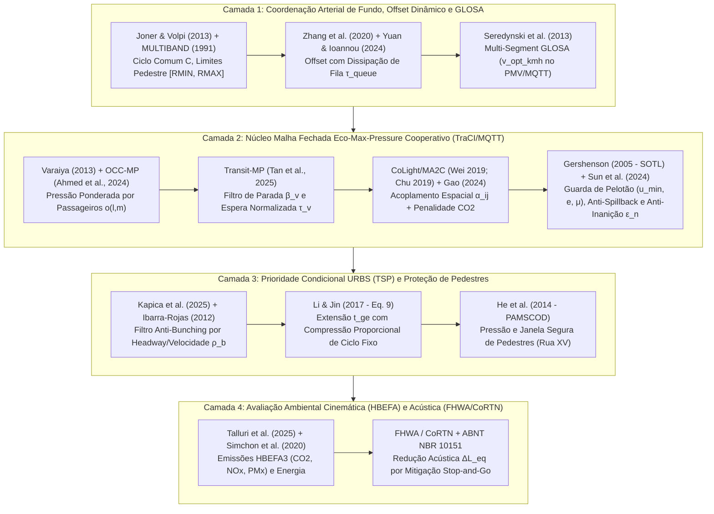

# Parecer Arquitetural e Decisão Algorítmica Definitiva — 11º Agente (Arquiteto-Chefe de Solução)

**Consórcio Multidisciplinar de Engenharia — UTFPR (Computação, Elétrica/Automação e Mecânica)**  
**Projeto:** Mobilidade Urbana, Sustentabilidade e Sistemas Ciber-Físicos no Quadrilátero Central de Curitiba  
**Área de Intervenção:** Setor Especial Estrutural e Quadrilátero Central (Av. Pres. Kennedy, Calçadão da Rua XV de Novembro, Av. Mal. Floriano Peixoto, Al. Dr. Muricy / Martim Afonso, Rua Mariano Torres e Av. Mário Tourinho)  
**Base Científica:** Síntese crítica de 40 artigos científicos analisados pelos 10 Agentes Leitores (`docs/relatorios_10_agentes.md`), confrontada com o `Manual_Projeto.pdf`, a base de código atual (`src/traci_controller.py`, `src/urbs_pipeline.py`, `src/geh_calibration.py`, `src/dashboard.py`) e os dados reais da URBS (`data/urbs_telemetry_hourly.csv` e `data/urbs_central_lines.csv`).

---

## 1. Diagnóstico do Sistema Atual (*As-Is*) e Requisitos CDIO (M1–M4)

### 1.1 Evidências Empíricas Extraídas da Telemetria Real da URBS (`data/`)
A execução do pipeline sobre os dados abertos da URBS e IPPUC no Quadrilátero Central (`BBOX = (-49.312, -25.480, -49.258, -25.424)`) revelou:
* **160 linhas de transporte coletivo mapeadas** cruzando a malha central (`data/urbs_central_lines.csv`), categorizadas no SUMO em três classes (`vType` com modelo `HBEFA3/Bus`):
  1. `urbs_brt` (Expresso Biarticulado / Ligeirão, $L = 24,0\text{ m}$, $v_{\max} = 16,67\text{ m/s}$): ex. **250 Ligeirão Norte/Sul** ($69,0\text{ part./h}$, $H^* = 52,2\text{ s}$, $\bar{v}_{\text{real}} = 26,08\text{ km/h}$), **203 Sta. Cândida/C. Raso** ($63,0\text{ part./h}$, $H^* = 57,1\text{ s}$, $\bar{v}_{\text{real}} = 23,51\text{ km/h}$), **602 Circular Sul Anti-Horário** ($52,0\text{ part./h}$, $H^* = 69,2\text{ s}$, $\bar{v}_{\text{real}} = 22,14\text{ km/h}$), **303 Centenário/C. Comprido** ($49,5\text{ part./h}$, $H^* = 72,7\text{ s}$, $\bar{v}_{\text{real}} = 21,01\text{ km/h}$).
  2. `urbs_ligeirinho` (Linha Direta Padron, $L = 13,0\text{ m}$, $v_{\max} = 16,67\text{ m/s}$): ex. **023 Inter 2 Anti-Horário** ($81,0\text{ part./h}$, $H^* = 44,4\text{ s}$, $\bar{v}_{\text{real}} = 23,31\text{ km/h}$), **022 Inter 2 Horário** ($66,5\text{ part./h}$, $H^* = 54,1\text{ s}$, $\bar{v}_{\text{real}} = 24,49\text{ km/h}$).
  3. `urbs_convencional` (Alimentador, Troncal e Convencional, $L = 12,0\text{ m}$, $v_{\max} = 15,0\text{ m/s}$).
* **Degradação severa nos horários de pico (`data/urbs_telemetry_hourly.csv`):** Enquanto na madrugada (02h–04h) a velocidade média real dos ônibus atinge $30,26\text{ a }31,01\text{ km/h}$, no pico da manhã (07h–08h, com **633 ônibus únicos/h**) cai para **$22,07\text{–}22,29\text{ km/h}$**, e no pico crítico da tarde (17h–18h, com **651 a 647 ônibus únicos/h** e mais de 98.600 amostras GPS) despenca para **$20,37\text{–}20,52\text{ km/h}$** (mediana de $20,22\text{ km/h}$, e até $19,07\text{ km/h}$ em linhas centrais críticas como `385 Cristo Rei` e `380 Detran/Vic. Machado`).

### 1.2 Diagnóstico Crítico do Controlador Atual (`src/traci_controller.py`)
No código atual (`apply_adaptive_control`, linhas 67–84), quando o tempo restante da fase é $\le 2,0\text{ s}$ e há um veículo da classe `bus` na faixa verde, aplica-se diretamente:
```python
traci.trafficlight.setPhaseDuration(tl_id, remaining + 5.0)
```
**Por que essa lógica é falha segundo os 40 artigos revisados?**
1. **Deriva de Offset (*Offset Drift* — Li & Jin, 2017):** Somar $+5,0\text{ s}$ sem comprimir as fases seguintes dilata o ciclo local de $C$ para $C + 5\text{ s}$, destruindo o *offset* relativo $\theta_i(1,j)$ e colapsando a Onda Verde arterial nos cruzamentos subsequentes.
2. **Agravamento de *Bus Bunching* (Kapica et al., 2025; Ibarra-Rojas & Rios-Solis, 2012):** Conceder prioridade cega a qualquer ônibus faz com que um veículo adiantado (com baixa ocupação) avance ainda mais rápido e alcance o ônibus da frente (atrasado e cheio), formando comboios.
3. **Cegueira ao Embarque/Desembarque (Tan et al., 2025 — Transit-MP):** O controlador atual verifica apenas `vClass == "bus"`, estendendo o sinal verde mesmo quando o ônibus está parado em estação-tubo ou ponto embarcando passageiros ($\beta_v = 0$), desperdiçando capacidade verde e gerando filas na via transversal.
4. **Ausência de Acoplamento Ambiental e de Filas a Jusante (Varaiya, 2013; Gao et al., 2024):** O contrato JSON (`queue_length_meters` e `co2_grams_per_second`) já é construído em `build_integration_payload()`, mas **não realimenta** a decisão de controle em malha fechada.

---

## 2. Avaliação Crítica Comparativa das Abordagens Isoladas

Para fundamentar a defesa em banca multidisciplinar (Rubricas 1 a 4 do Manual), a Tabela 1 sintetiza por que **nenhuma abordagem isolada** resolve simultaneamente as restrições do Quadrilátero Central de Curitiba:

| Abordagem Isolada | Artigos de Referência | Vantagem Principal | Por que FALHA sozinha no Centro de Curitiba? |
| :--- | :--- | :--- | :--- |
| **1. Onda Verde MILP Pura (Offline)** | Little (1966); MAXBAND (1981); Joner & Volpi (2013) | Garante progressão arterial matemática e limites de vermelho para pedestres $[RMIN, RMAX]$. | Assume fluxo determinístico sem filas residuais. No centro de Curitiba, as restrições de fechamento de malha ($2c_l \in \mathbb{Z}$) engessam os *loops* ortogonais e as filas paradas bloqueiam a cabeça do pelotão. |
| **2. Auto-Organização Pura (SOTL)** | Gershenson (2005) | Zero custo computacional central; regras locais anti-corte de pelotão ($e, \mu$) e anti-*spillback* ($\omega$). | É puramente reativo local: não possui coordenação de ciclo mestre para corredores estruturais de BRT nem diferencia ocupação de passageiros ou *headway* das linhas URBS. |
| **3. Max-Pressure Clássico Puro** | Varaiya (2013); Sun et al. (2024) | Estabilidade máxima da malha provada por Lyapunov sem precisar de matriz O-D. | Trata 1 carro (1,5 pax) igual a 1 biarticulado (100+ pax); é acíclico por natureza, podendo interromper pelotões arteriais recém-formados se não houver restrição de banda/pelotão. |
| **4. MARL Caixa-Preta (Deep RL)** | PressLight/CoLight (2019); MA2C (2019); eMARLIN+ (2024) | Captura interações espaço-temporais entre cruzamentos vizinhos ($\alpha, \alpha_{ij}$). | Redes neurais profundas exigem milhões de passos de treino, não oferecem garantia formal de segurança de travessia de pedestres (NBR/CNT) e têm baixa explicabilidade perante banca de engenharia. |
| **5. TSP Cego (+5 s na Fase Atual)** | Implementação atual do `traci_controller.py` | Simples implementação em TraCI. | Causa *offset drift* (quebra a onda verde), ignora se o ônibus está parado embarcando no tubo e agrava o *bus bunching* em linhas de alta frequência (ex.: Inter 2 e Ligeirão). |
| **6. GLOSA Isolado** | Seredynski et al. (2013); Kopp et al. (2013) | Suaviza a cinemática veicular e reduz frenagens bruscas. | Depende de previsibilidade do instante de início do verde ($\Delta t_{\text{verde}}$) e do tempo de dissipação de fila ($\tau_{\text{queue}}$); colapsa se o semáforo mudar de fase caoticamente. |

---

## 3. Decisão Arquitetural Definitiva: Arquitetura Híbrida **CWB-EcoSync-4L**

A solução escolhida para o consórcio é a arquitetura híbrida de quatro camadas **CWB-EcoSync-4L** (*Curitiba Cyber-Physical Eco-Multimodal Cooperative Synchronization — 4 Layers*).

A **CWB-EcoSync-4L** elimina as fraquezas individuais ao combinar a **estabilidade estrutural de ciclo e banda arterial** (Camada 1) com o **controle em malha fechada guiado por pressão multimodal, espacial e ambiental** (Camada 2), **prioridade condicional de ônibus com compensação exata de ciclo e proteção de pedestres** (Camada 3) e **quantificação física rigorosa de emissões e acústica urbana** (Camada 4).



---

## 4. Especificação Matemática Completa das 4 Camadas

### Camada 1 — Coordenação Arterial de Fundo, Offset com Dissipação de Fila e GLOSA
**Fundamentação Científica:** *Little (1966)*; *Little, Kelson & Gartner (1981 — MAXBAND)*; *Gartner et al. (1991 — MULTIBAND)*; *Joner & Volpi (2013 — Malha de Curitiba)*; *Zhang et al. (2015 — AM-Band)*; *Friedman, Mark & Gartner (2025)*; *Zhang et al. (2020)*; *Yuan & Ioannou (2024)*; *Seredynski et al. (2013)*.

1. **Plano Base de Referência e Restrições de Segurança (Joner & Volpi, 2013 + MULTIBAND, 1991):**
   Cada interseção $j$ de uma artéria $i$ opera sob uma frequência de referência $z = 1/C$ (ciclo comum $C \in [T_1, T_2]$, ex.: $C = 90\text{ s}$ no pico), respeitando obrigatoriamente os limites de fração de vermelho $RMIN_{ij} \le r_{ij} \le RMAX_{ij}$ para travessia segura de pedestres, idosos e PCDs no Centro de Curitiba, e o fechamento geométrico de malha:
   $$\sum_{(j_k, j_m) \in \text{Loop } l} m(j_k, j_m) = 2 c_l, \quad c_l \in \mathbb{Z}$$
   onde as larguras de banda por segmento $b_{ij}$ são ponderadas pela razão volume/capacidade $V_{ij}/C_{ij}$ (*MULTIBAND*) e admitindo assimetria direcional (*AM-Band*, Zhang et al., 2015; *Ondas Anisotrópicas* $\alpha \neq \beta$, Friedman et al., 2025) para refletir os binários e vias de sentido único do Quadrilátero Central (ex.: Mariano Torres, Mal. Floriano, Al. Dr. Muricy).

2. **Tempo de Dissipação da Fila Residual ($\tau_{\text{queue}}$ — Zhang et al., 2020):**
   A partir da métrica `queue_length_meters` ($L_{q,ij}$) do Contrato JSON/MQTT na aproximação $(i,j)$, calcula-se o atraso de limpeza da fila parada antes que a cabeça do pelotão em movimento possa cruzar a linha de retenção:
   $$\tau_{\text{queue}, ij}(t) = \frac{L_{q,ij}(t)}{v_{\text{shockwave}}}, \quad \text{com } v_{\text{shockwave}} \approx 4,5\text{ a }5,5\text{ m/s}$$

3. **Offset Efetivo Dinâmico ($T_{o,ij}$ — Joner & Volpi, 2013 + Zhang et al., 2020 + Yuan & Ioannou, 2024):**
   O *offset* operacional entre os cruzamentos adjacentes $j$ e $j+1$ separados pela distância de quadra $L_{j,j+1}$, calibrado com a velocidade média real dos corredores ($\bar{v}_{\text{real}} \approx 20,37\text{ km/h} = 5,66\text{ m/s}$ no pico das 17h–18h em `data/urbs_telemetry_hourly.csv`), é ajustado continuamente descontando $\tau_{\text{queue}}$:
   $$T_{o, j \to j+1}(t) = \left( \frac{L_{j,j+1}}{\max(\bar{v}_{j,j+1}(t), v_{\min})} - \tau_{\text{queue}, j+1}(t) \right) \pmod{C}$$

4. **Velocidade Recomendada Multi-Segment GLOSA ($v_{\text{opt, kmh}}$ — Seredynski et al., 2013; Talluri et al., 2025):**
   Para suavizar a chegada dos pelotões e alimentar os Painéis de Mensagem Variável (PMV) via MQTT e o Dashboard Streamlit:
   $$v_{\text{opt, kmh}}(t) = \text{clip}\left( 3,6 \cdot \frac{L_{j,j+1}}{\Delta t_{\text{verde\_inicio}, j+1}(t) + \tau_{\text{queue}, j+1}(t)}, \, v_{\min}=25,0\text{ km/h}, \, v_{\max}=50,0\text{ km/h} \right)$$

---

### Camada 2 — Controle em Malha Fechada Multimodal Eco-Max-Pressure Cooperativo (Núcleo TraCI/MQTT)
**Fundamentação Científica:** *Varaiya (2013)*; *Ahmed, Liu & Gayah (2024 — OCC-MP)*; *Tan et al. (2025 — Transit-MP)*; *Wei et al. (2019 — PressLight/CoLight)*; *Chu et al. (2019 — MA2C)*; *Gershenson (2005 — SOTL)*; *Sun et al. (2024)*; *Gao et al. (2024)*.

Em vez de comutar fases de forma cega, o núcleo em malha fechada calcula a cada janela de decisão a **Pressão Multimodal Eco-Cooperativa** de cada fase semafórica $p \in \mathcal{P}_i$ do cruzamento $i$:

1. **Carga Ponderada por Passageiros e Tempo de Espera com Filtro de Embarque (OCC-MP, Ahmed et al., 2024 + Transit-MP, Tan et al., 2025):**
   Para cada faixa de entrada $l$, cada veículo $v \in \mathcal{V}_l(t)$ contribui com sua ocupação estimada de passageiros $p_v$ e seu tempo de viagem/espera normalizado $\tau_v(t)$, filtrado pela variável binária de operação $\beta_v(t) \in \{0, 1\}$:
   $$X_{\text{occ}}(l, t) = \frac{1}{L_{\max, l}} \sum_{v \in \mathcal{V}_l(t)} \beta_v(t) \cdot p_v \cdot \tau_v(t)$$
   onde:
   * **Pesos de ocupação modal ($p_v$):**
     * `urbs_brt` (Expresso / Ligeirão): $p_v = 100,0\text{ pax}$
     * `urbs_ligeirinho` (Linha Direta): $p_v = 50,0\text{ pax}$
     * `urbs_convencional` (Alimentador / Troncal / Convencional): $p_v = 35,0\text{ pax}$
     * Automóvel privado (`passenger`): $p_v = 1,5\text{ pax}$
   * **Filtro de parada em estação-tubo/ponto ($\beta_v$ — Tan et al., 2025):**
     $$\beta_v(t) = \begin{cases} 0, & \text{se } v \text{ é ônibus parado } (v_v < 0,1\text{ m/s}) \text{ fora da zona de fila } (d_{\text{stop\_line}} > L_{q,l} + 15\text{ m}) \\ 1, & \text{caso contrário} \end{cases}$$
   * **Fator incremental de espera ($\tau_v$ — Tan et al., 2025):**
     $$\tau_v(t) = 1,0 + \frac{t_{\text{wait}, v}(t)}{\text{ETT}_l}, \quad \text{com } \text{ETT}_l = \frac{L_l}{v_{\max, l}}$$

2. **Peso do Movimento $(l,m)$ com Prevenção de *Spillback* a Jusante (Varaiya, 2013 + Ahmed et al., 2024):**
   Para cada conexão $(l, m)$ entre a faixa de entrada $l$ e a faixa receptora a jusante $m$ (obtida via `traci.trafficlight.getControlledLinks(tl_id)`):
   $$w_{\text{occ}}(l, m, t) = \omega_{\text{spillback}}(m, t) \cdot \left[ X_{\text{occ}}(l, t) - \sum_{n \in \mathcal{D}(m)} r(m, n) X_{\text{occ}}(m, t) \right]^+$$
   onde $[x]^+ = \max(x, 0)$ e $\omega_{\text{spillback}}(m, t) \in \{0, 1\}$ é a **Regra 6 do SOTL (Gershenson, 2005)**: se a ocupação da faixa receptora a jusante $m$ exceder $85\%$ ($\text{occ}_m > 0,85$), define-se $\omega_{\text{spillback}}(m, t) = 0$.

3. **Função de Pressão Eco-Multimodal Local com Penalidade de $\text{CO}_2$ e Pedestres (Gao et al., 2024 + He et al., 2014 + Sun et al., 2024):**
   $$P_i(p, t) = \sum_{(l,m) \in p} s_{lm} \, w_{\text{occ}}(l, m, t) + \eta_{\text{CO}_2} \sum_{l \in p} \dot{E}_{\text{CO}_2, l}(t) + \eta_{\text{ped}} N_{\text{ped}, p}(t) + \eta_{\text{starv}} \, \varepsilon_{i,p}(t)$$

4. **Acoplamento Grafo-Espacial Cooperativo via MQTT (Wei et al., 2019 — CoLight; Chu et al., 2019 — MA2C):**
   $$\tilde{P}_i(p, t) = P_i(p, t) + \alpha \sum_{j \in \mathcal{N}_i} \alpha_{ij}(t) \, P_j(p, t) + \eta_{\text{band}} \, B_{i,p}(t)$$
   onde $\alpha = 0,75$, $\alpha_{ij}(t) = \frac{q_{j \to i}(t)}{\sum_{k \in \mathcal{N}_i} q_{k \to i}(t) + \epsilon}$ e $B_{i,p}(t) \in \{0, 1\}$ vale $1$ quando a fase $p$ coincide com a janela da banda verde arterial da Camada 1 no instante $t \pmod C$.

5. **Regras de Guarda SOTL para Comutação Segura (Gershenson, 2005):**
   A fase ativa $p_{\text{atual}}$ só pode ser trocada para $p^* = \arg\max_{p} \tilde{P}_i(p, t)$ se e somente se:
   * **Regra 1 (Verde Mínimo $u_{\min}$):** $\phi_i \ge u_{\min}$ (ex.: $u_{\min} = 10\text{ s}$);
   * **Regras 3 e 4 (Integridade e Limite de Pelotão $e, \mu$):** Não há pelotão compacto ($\le \mu = 15\text{ veículos}$) cruzando a zona crítica a menos de $e = 25\text{ m}$ da linha de retenção com velocidade $v > 3,0\text{ m/s}$.

---

### Camada 3 — Prioridade Semafórica Condicional para Ônibus/BRT da URBS e Proteção de Pedestres
**Fundamentação Científica:** *Li & Jin (2017 — Eq. 9)*; *Kapica, Melnikova & Naumov (2025)*; *Ibarra-Rojas & Rios-Solis (2012)*; *Ceder, Golany & Tal (2001)*; *He, Head & Ding (2014 — PAMSCOD)*.

1. **Condição Anti-Bunching por Regularidade de Headway/Velocidade ($\rho_b$ — Kapica et al., 2025; Ibarra-Rojas & Rios-Solis, 2012):**
   $$\rho_b(t) = \max\left( \frac{H_{\text{atual}, b}(t)}{H_k^*}, \, \frac{v_{\text{ref}, k}}{\max(v_b(t), 5,0\text{ km/h})} \right)$$
   * **Regra de Ativação Condicional:** A solicitação de prioridade semafórica ativa (TSP) **só é habilitada** se $\rho_b(t) > 1,05$ e $\beta_b(t) = 1$. Se $\rho_b(t) < 0,90$ (ônibus adiantado), a prioridade extra é **suprimida** para evitar *bus bunching*.

2. **Extensão de Verde com Compensação Proporcional de Ciclo Fixo (Li & Jin, 2017 — Eq. 9):**
   $$g_{ge}^a = g^a + t_{ge}, \qquad g_{ge}^m = \max\left( g_{\min}^m, \, g^m \left( 1 - \frac{t_{ge}}{C - L_{\text{lost}} - g^a} \right) \right), \quad \forall m \neq a$$

---

### Camada 4 — Avaliação Ambiental Cinemática (HBEFA3/PHEMlight) e Acústica Urbana (FHWA/CoRTN + ABNT NBR 10151)
**Fundamentação Científica:** *Talluri, Stang & Weidl (2025)*; *Simchon et al. (2020)*; *Gao et al. (2024)*; *Tomar et al. (2022)*; *Norma ABNT NBR 10151*; *Diretrizes GEH da FHWA*.

1. **Validação Estatística de Calibração (Índice GEH — Marco 2):**
   $$\text{GEH}_k = \sqrt{\frac{2 (M_k - C_k)^2}{M_k + C_k}} < 5,0 \quad \text{em } \ge 85\% \text{ das vias monitoradas}$$

2. **Modelagem Cinemática Microscópica de Emissões (HBEFA3 / PHEMlight):**
   $$E_{\text{total}, \text{pol}} = \sum_{t=1}^{T_{\text{sim}}} \sum_{v \in \mathcal{V}(t)} \dot{e}_{\text{pol}}\big(v_v(t), a_v(t), \text{vType}_v\big) \cdot \Delta t, \quad \text{pol} \in \{\text{CO}_2, \text{NO}_x, \text{PM}_x\}$$

3. **Modelagem Acústica Urbana e Nível de Pressão Sonora Equivalente ($L_{eq}$ — FHWA / CoRTN + ABNT NBR 10151):**
   $$L_{eq}(t) = L_0 + 10 \log_{10}\left( Q_{\text{car}}(t) + E_{\text{bus}} Q_{\text{bus}}(t) + \kappa_{\text{stop}} N_{\text{halting}}(t) \right) + 20 \log_{10}\left(\frac{\bar{v}_{\text{ef}}(t)}{v_{\text{ref}}}\right) - \Delta L_{\text{dist}}$$

---

## 5. Quadro-Resumo de Rastreabilidade Científica (Defesa em Banca)

| Módulo da Solução **CWB-EcoSync-4L** | Equação / Mecanismo Técnico | Artigos do Consórcio que Sustentam a Decisão |
| :--- | :--- | :--- |
| **Ciclo Comum, Loops e Segurança de Pedestres** | $2c_l = \sum m(j_k, j_m)$, $RMIN_{ij} \le r_{ij} \le RMAX_{ij}$ | Little (1966); Little, Kelson & Gartner (1981); **Joner & Volpi (2013 — Curitiba)**; He et al. (2014 — PAMSCOD) |
| **Banda Assimétrica e Offset com Limpeza de Fila** | $\tau_{\text{queue}} = L_q / v_{\text{shockwave}}$, $T_o = (L/\bar{v} - \tau_{\text{queue}}) \pmod C$ | Gartner et al. (1991 — MULTIBAND); Zhang et al. (2015 — AM-Band); Friedman et al. (2025); **Zhang et al. (2020)**; Yuan & Ioannou (2024) |
| **Recomendação de Velocidade (GLOSA / PMV)** | $v_{\text{opt}} = \text{clip}(3,6 \cdot L / (\Delta t_{\text{verde}} + \tau_{\text{queue}}), 25, 50)$ | **Seredynski et al. (2013)**; Kopp et al. (2013); Bhattacharyya et al. (2022) |
| **Núcleo Multimodal OCC-MP + Transit-MP** | $w_{\text{occ}}(l,m)$ ponderado por $p_v \in \{100, 50, 35, 1.5\}$, filtro $\beta_v \in \{0,1\}$ e espera $\tau_v$ | **Varaiya (2013)**; **Ahmed, Liu & Gayah (2024 — OCC-MP)**; **Tan et al. (2025 — Transit-MP)** |
| **Guarda de Pelotão, Anti-Spillback e Anti-Inanição** | Verde mínimo $u_{\min}$, zona de pelotão $(e, \mu)$, bloqueio $\omega_{\text{spillback}}$ e contador $\varepsilon_n$ | **Gershenson (2005 — SOTL)**; **Sun et al. (2024 — SUMO/TraCI)** |
| **Acoplamento Grafo-Espacial via MQTT** | $\tilde{P}_i(p) = P_i(p) + \alpha \sum_{j \in \mathcal{N}_i} \alpha_{ij}(t) P_j(p)$, $\alpha = 0,75$ | **Wei et al. (2019 — PressLight & CoLight)**; **Chu et al. (2019 — MA2C)**; Wang et al. (2024 — eMARLIN+) |
| **TSP Condicional Anti-Bunching + Ciclo Fixo** | Filtro de regularidade $\rho_b > 1,05$ e compressão proporcional $g_{ge}^m = g^m(1 - \frac{t_{ge}}{C-L-g^a})$ | **Li & Jin (2017 — Eq. 9)**; **Kapica et al. (2025)**; Ibarra-Rojas & Rios-Solis (2012); Ceder et al. (2001) |
| **Otimização Ambiental HBEFA e Acústica Urbana** | Penalidade de $\dot{E}_{\text{CO}_2}$ na pressão da fase e modelo logarítmico $L_{eq}$ (FHWA/CoRTN) | **Gao et al. (2024)**; **Simchon et al. (2020)**; **Talluri et al. (2025)**; Tomar et al. (2022); ABNT NBR 10151 |
